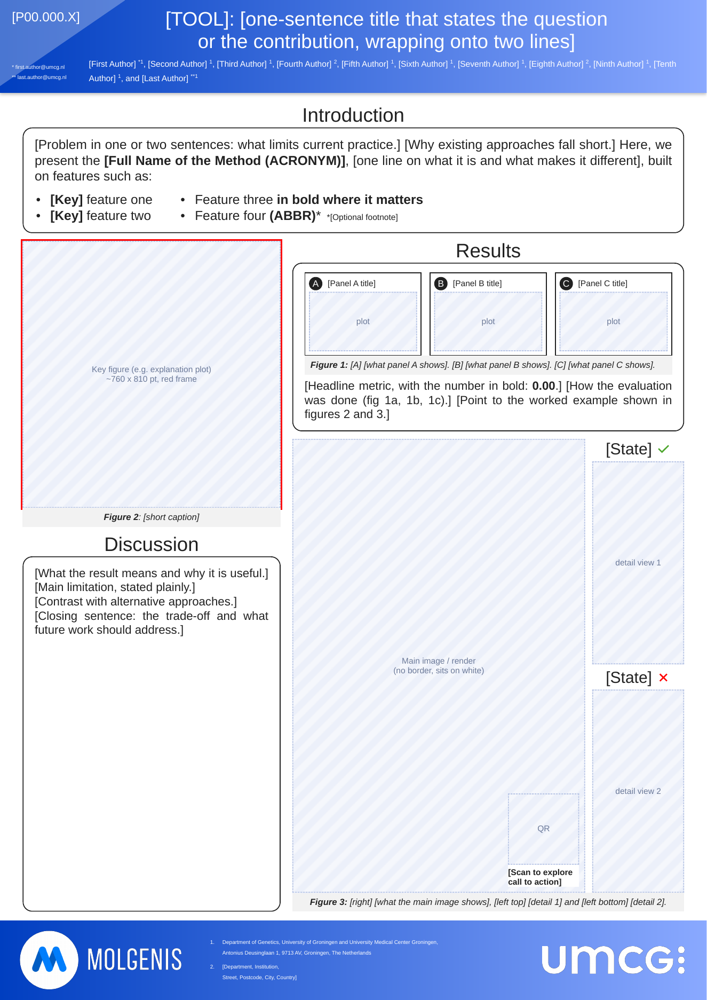
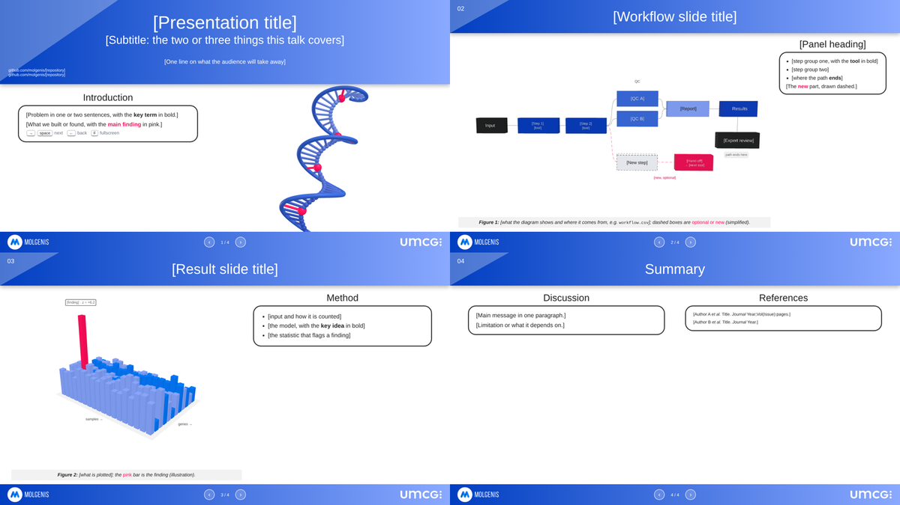

# style

Style folder and guides for presentations, applications and documents — so posters,
slides and pages can be reproduced consistently by hand or by an AI assistant.

Templates:

- **A0 portrait conference poster**, derived from the DAVE poster (ESHG 2025).
- **16:9 presentation with 3D figures** (Three.js), derived from the internal talk
  *RNA in diagnostics and research*.





## Layout

```
/css
    index.css          shared design tokens (colours, fonts, strokes, radius)
    poster.css         A0 poster layout and components
    presentation.css   16:9 slide layout and components
/fonts
    /liberation-sans   Helvetica-metric fallback font (SIL OFL 1.1, see OFL.txt)
/assets
    /logos             MOLGENIS and UMCG logos (white, transparent PNG)
/templates
    /poster
        poster-a0.html A0 poster template with placeholders
    /presentation
        presentation-16x9.html  slide template with the 3D engine (title, workflow,
                                result and text slides)
/scripts
    render-poster.sh   HTML -> print-ready PDF (+ PNG preview) via headless Chrome
    render-slides.sh   HTML presentation -> one PNG per slide, for review
    bundle-presentation.py  HTML presentation -> one self-contained file to share
/docs
    poster-style.md    measured style guide: sizes, colours, type, components
    presentation-style.md  slide rules: bands, text, 3D figures, motion, delivery
/prompts
    prompts.md         copy-paste prompts for reproducing the style with AI
/reference
    *.png              previews of the source poster and the rendered template
```

## Make a poster

1. Copy `templates/poster/poster-a0.html` (keep it inside `templates/poster/` or fix the
   relative `../../css` and `../../assets` paths).
2. Replace the `[bracketed]` text and swap each `.placeholder` box for an `` or `<svg>`.
3. Render:

   ```bash
   scripts/render-poster.sh templates/poster/my-poster.html my-poster.pdf my-poster.png
   ```

   Requires Google Chrome or Chromium; the PNG preview needs `pdftoppm` (poppler).
4. Check the preview: text must not overflow panels or the page.

Fonts: real Helvetica/Arial is used when installed, otherwise the bundled Liberation Sans
(same metrics), so line breaks stay the same across machines.

## Make a presentation

1. Copy `templates/presentation/presentation-16x9.html` next to it (or fix the relative
   `../../css` and `../../assets` paths).
2. Replace the `[bracketed]` text. Each slide is a `<section class="slide">`; a slide with
   `data-scene="name"` gets the 3D scene `SCENES.name` from the script in its `.stage`.
   Edit the example scenes (`helix`, `flow`, `bars`) or add your own; `flowDiagram({...})`
   draws a pipeline from a list of nodes and edges, with the one-off wave.
3. Follow `docs/presentation-style.md`, especially the motion rules (§ 6).
4. Check every slide:

   ```bash
   scripts/render-slides.sh templates/presentation/my-talk.html out/
   ```

   Requires Google Chrome or Chromium and a network connection (Three.js loads from
   jsDelivr).
5. Bundle into one shareable file (CSS and logos inlined):

   ```bash
   python3 scripts/bundle-presentation.py templates/presentation/my-talk.html my-talk.html
   ```

   Add `--embed-fonts` to include Liberation Sans (+ ~1.6 MB).

Navigation: → / space next, ← back, F fullscreen; `#slide-3` opens slide 3.

## Adding a new style

Use the second prompt in `prompts/prompts.md`: measure the reference, add tokens to
`css/index.css` only when they are new, then add a stylesheet, template, guide and prompt.
